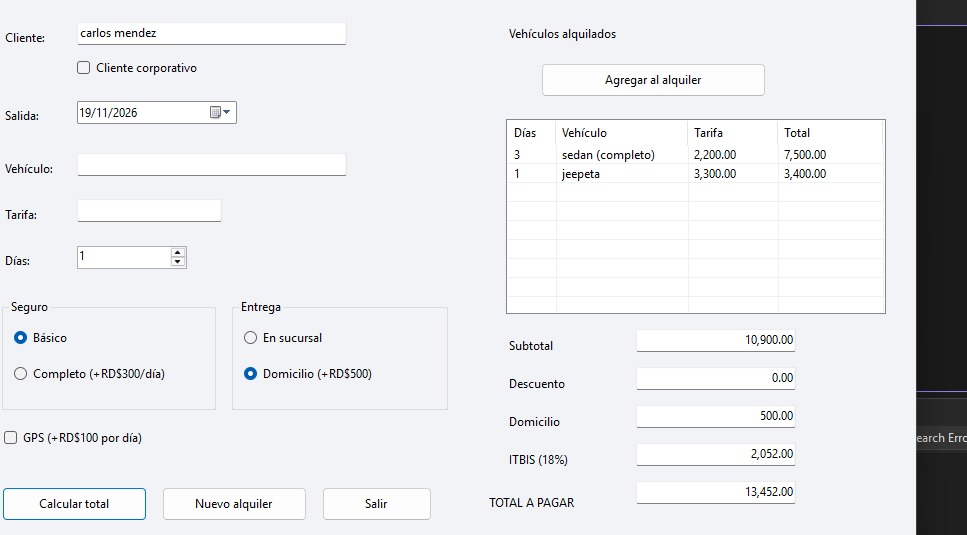

# examen_2do_parcial_marlon_de_la_cruz
# RentCar Express – Sistema de Alquiler de Vehículos

## Segundo Parcial – Programación Básica

**Estudiante:** Marlon de la Cruz  
**Matrícula:** 2024-2910  
**Docente:** Gamalier Reyes  
**Universidad:** Universidad Central del Este (UCE)

## Descripción del proyecto

RentCar Express es una aplicación desarrollada en C# utilizando Windows Forms, que permite registrar alquileres de vehículos y calcular el monto total que debe pagar un cliente.

Este proyecto fue realizado como parte del segundo parcial de Programación Básica, con el propósito de poner en práctica los conocimientos adquiridos sobre programación orientada a objetos, eventos, métodos y desarrollo de interfaces gráficas.

## Funcionalidades

- Registro de clientes y vehículos.
- Cálculo de tarifas según los días de alquiler.
- Opciones de seguro básico o completo.
- Servicio adicional de GPS.
- Descuento para clientes corporativos.
- Cálculo de entrega a domicilio e ITBIS.
- Listado de alquileres y cálculo del total a pagar.
- Opciones para agregar, eliminar y limpiar registros.

## Conclusión

Este proyecto me permitió fortalecer mis conocimientos en C#, especialmente en el manejo de formularios, controles, eventos y operaciones matemáticas aplicadas a un sistema de alquiler de vehículos.

ejecucion del proyecto:

